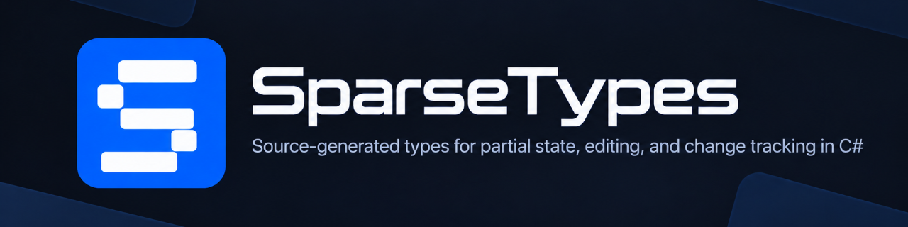

# SparseTypes

[](https://www.nuget.org/packages/SparseTypes/)  [![DeepWiki](https://img.shields.io/badge/DeepWiki-SparseTypes-blue.svg?logo=)](https://deepwiki.com/arika0093/SparseTypes)

*End-to-end change management for .NET.*

From live UI drafts and Undo/Redo to wire transport, concurrent rebase, and database persistence, all generated from your existing C# models.

Add `[SparseModel]` to a standard `partial` class. The Roslyn source generator equips it with companion types for partial state, patch commands, diff transitions, JSON payloads, and reactive edit sessions automatically.

### Where it helps in real systems

* **Editable forms and dashboards**: Track touched fields (`IsChanged`), provide Undo/Redo, and drag-and-drop reorder collection items without writing bespoke ViewModel plumbing.
* **Web APIs and partial updates**: Distinguish between "set to null" and "omitted from request" with compile-time type safety.
* **Layered configuration**: Merge system defaults, environment overrides, and tenant settings without default values clobbering lower layers.
* **Concurrent editing and collaboration**: Rebase client edits onto current server state. Non-conflicting fields merge automatically, and only identical-property clashes raise conflicts.
* **Targeted persistence**: Apply only modified properties directly to EF Core tracked entities or SQL stores instead of full entity replacements.

### Why SparseTypes?

* **One model produces the entire stack**: Annotate a standard C# model once. The generator emits partial fragments, patch commands, diff transitions, JSON payloads, and reactive edit sessions without manual DTO variants.
* **100% type-safe and refactoring-friendly**: Normal C# property assignment replaces error-prone string paths and runtime reflection.
* **Zero reflection and Native AOT ready**: All companion code is emitted at compile time. It allocates minimally, trims cleanly, and runs on Native AOT.
* **Identity-based collection tracking**: Marking collection items with `[SparseKey]` tracks additions, removals, edits, and reorders by ID rather than fragile array positions.
* **Git-style three-way rebase**: Resolves concurrent changes cleanly instead of discarding work with blunt last-write-wins or total concurrency errors.

### Try it live: SparseTypes Playground

Experience full change workflows in the browser: [**SparseTypes Playground**](https://arika0093.github.io/SparseTypes/)

* **Basics**:
  * [Case 1: Layer merge](https://arika0093.github.io/SparseTypes/case-1): Compose multi-layer settings with fall-through semantics.
  * [Case 2: Typed patch](https://arika0093.github.io/SparseTypes/case-2): Build and apply baseline-free patch commands with explicit null support.
* **UI and Collections**:
  * [Case 3: Keyed list](https://arika0093.github.io/SparseTypes/case-3): Reorder, insert, and edit collection items by stable key.
  * [Case 4: Edit session and Undo/Redo](https://arika0093.github.io/SparseTypes/case-4): Reactive UI editing, dirty state tracking, and history management.
* **Persistence and Concurrency**:
  * [Case 5: EF Core mapping and Rebase](https://arika0093.github.io/SparseTypes/case-5): Save ChangeSets to tracked entities and rebase concurrent edits during simulated network delay.
  * [Case 6: Heterogeneous sessions](https://arika0093.github.io/SparseTypes/case-6): Coordinate multiple edit sessions across distinct model types.

## Install

```shell
dotnet add package SparseTypes
```

The package contains the source generator, so no additional generation step is required.

## Quick Start

With the .NET 10 SDK or later, the whole example fits in a single file. It layers an environment override over defaults, applies one user edit, and prints the effective values with the typed transition.

<!-- sample: readme-quickstart -->
```csharp
#:package SparseTypes@*

using SparseTypes;

// 1. Snapshot complete defaults
var defaults = Settings.Fragment.From(new Settings
{
    Label = "default",
    Database = new() { Host = "db.local", Port = 5432 },
});

// 2. Define an override with only Port specified
var environment = new Settings.Fragment
{
    Database = new DatabaseSettings.Fragment { Port = 6432 },
};

// 3. Merge layers (unspecified members fall through)
var effective = defaults.Merge(environment);

// 4. Apply a targeted patch
var patch = new Settings.Patch { Label = "production" };
patch.Database.Port = 7432;
var updated = effective.Apply(patch);

// 5. Inspect the transition between states
var changes = Settings.ChangeSet.Between(effective, updated);

Console.WriteLine(updated.ToModel().Label);            // production
Console.WriteLine(updated.ToModel().Database!.Host);   // db.local, preserved by the patch
Console.WriteLine(changes.Label.IsChanged);            // True
Console.WriteLine(changes.Database.Port.Before.Value); // 6432
Console.WriteLine(changes.Database.Port.After.Value);  // 7432

[SparseModel]
public partial class Settings
{
    public string? Label { get; set; }
    public DatabaseSettings? Database { get; set; }
}

public partial class DatabaseSettings
{
    public string Host { get; set; } = "localhost";
    public int Port { get; set; } = 5432;
}
```
<!-- /sample -->

Save it as `quickstart.cs` and run:

```shell
dotnet run --file quickstart.cs
```

Unassigned members fall through on `Merge`. `Patch` applies targeted edits without requiring a baseline.
`ChangeSet` captures typed before-to-after transitions with exact `IsChanged` flags.

### Wire transport and concurrent rebase

When changes cross process boundaries, serialize the change set into JSON and reconcile against the latest server state:

<!-- illustrative: excerpt; crosses process boundaries with System.Text.Json -->
```csharp
// 1. Serialize the typed change set for wire transport
var json = JsonSerializer.Serialize(changes.ToPayload());
// 2. Deserialize on the server
var incoming = JsonSerializer.Deserialize<Settings.ChangePayload>(json)!.ToChangeSet();
// 3. Rebase incoming changes onto latest server state
var rebased = incoming.RebaseOnto(updated);
```
`RebaseOnto` compares the client's original baseline against the latest server state.
Independent properties merge automatically without overwriting concurrent edits, while collisions on the same property surface as structured conflicts.

## Architecture: The Generated Core

The source generator emits companion types designed to work together across the change lifecycle:

| Generated Type | Role | Typical Use |
| --- | --- | --- |
| `Fragment` | Sparse state snapshot | Default layers, overrides, partially supplied values |
| `Patch` | Requested operations | Baseline-free commands, targeted API requests |
| `ChangeSet` | Before-to-after transition | Audit logs, undo/redo, conflict-aware rebase |
| `ChangePayload` | Wire envelope | Versioned JSON transport across process boundaries |
| `EditSession` | Reactive UI draft | Dirty tracking, Undo/Redo, batch editing in Blazor/Desktop |

### Presence tracking with Optional<T>

A `Fragment` represents your model where every member is wrapped in `Optional<T>`.
This enables three distinct states that standard C# properties cannot distinguish at once:

<!-- sample: readme-optional-states -->
```csharp
Optional<string?> missing = Optional<string?>.Missing;
Optional<string?> value = "hello";
Optional<string?> explicitNull = Optional<string?>.Present(null);
```
<!-- /sample -->

Missing means unassigned (falling through during merge), present `null` explicitly clears a value, and present value updates it.

## Documentation

Browse the documentation organized by the [Diátaxis](https://diataxis.fr/) framework:

### Tutorials (Learning by doing)
* [First sparse edit](docs/tutorial/first-sparse-edit.md): Build a working edit pipeline end to end.

### How-to Guides (Goal-oriented recipes)
* [Layered settings](docs/how-to/layered-settings.md): Compose multi-tier configuration and remove overrides.
* [Partial updates](docs/how-to/partial-updates.md): Accept patch commands or baseline-aware changes in Web APIs.
* [Blazor edit form](docs/how-to/blazor-edit-form.md): Save form edits without losing draft state.
* [Blazor headless components](docs/how-to/blazor-headless-components.md): Build custom UI inputs over session paths.
* [EF Core mapping](docs/how-to/efcore-mapping.md): Persist ChangeSets to databases with Entity Framework Core.

### Explanation (Concepts and design)
* [Fragments and patches](docs/explanation/fragments-and-patches.md): Four core sparse states, algebraic operations, and lifecycle.
* [ChangeSet rebase](docs/explanation/rebase.md): Three-way reconciliation, conflict detection, and server save flows.
* [Keyed collections](docs/explanation/keyed-collections.md): Identity-based list operations vs. index-based mutation.
* [Cloning and ownership](docs/explanation/cloning-and-ownership.md): Instance isolation and memory safety guarantees.
* [Merge strategies](docs/explanation/merge-strategies.md): Deep merge, collection append, set union, and custom rules.
* [UI frameworks & Edit sessions](docs/explanation/ui-frameworks.md): Framework-neutral editing model for Blazor, WPF, WinForms, MAUI, and Avalonia.
* [Edit-session groups](docs/explanation/edit-session-groups.md): Coordinating multiple edit sessions across distinct models.

### Reference (Technical facts and APIs)
* [ChangePayload wire format](docs/reference/change-payload.md): JSON schema and serialization specification.
* [Descriptors reference](docs/reference/descriptors.md): Reflection-free runtime metadata and dynamic accessors.
* [Model shapes](docs/reference/model-shapes.md): Supported C# shapes, modifiers, and constructor requirements.
* [Diagnostics](docs/reference/analyzer.md): Roslyn analyzer rules (`SPF001`-`SPF035`).

## Packages and Compatibility

### SparseTypes
* Core runtime and source generator: targets `netstandard2.0` (compatible with .NET 6+, .NET 8+, .NET 10+, and modern .NET runtimes).
* Requires Roslyn 4.3.1 or later (Visual Studio 2022 17.3+, JetBrains Rider 2023.1+, .NET SDK 6.0+).
* Generated code requires C# 9.0 or later.

### SparseTypes.Blazor
* Reactive edit sessions and field components for Blazor applications.
* Targets `net8.0` and `net10.0`.

### SparseTypes.EntityFrameworkCore
* ChangeSet mapping and change tracking integration for Entity Framework Core.
* Targets `net10.0`.

## License

Licensed under the Apache-2.0 License.
